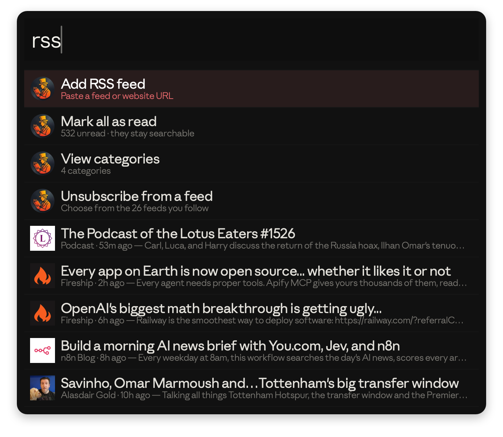
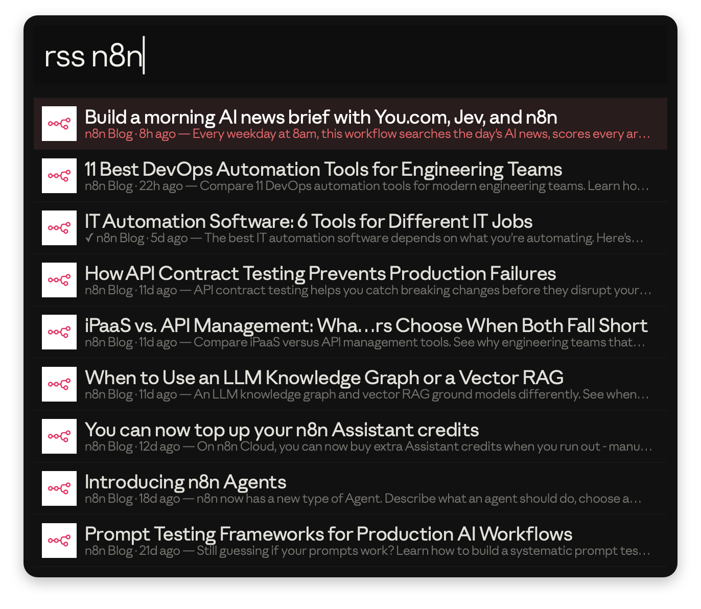
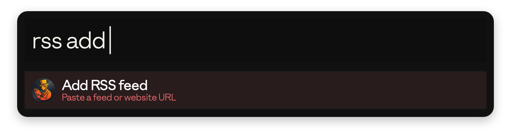
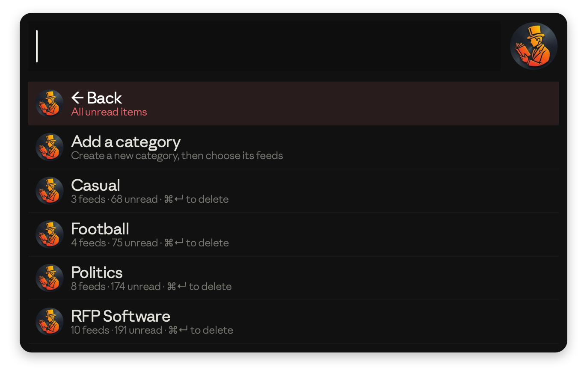
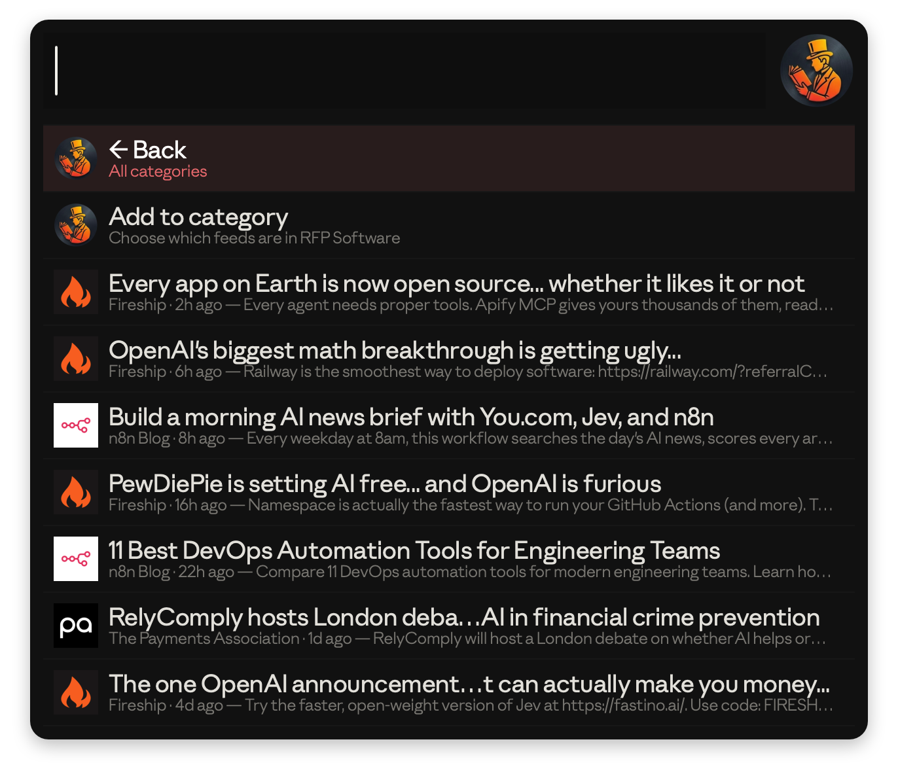

# Alfred RSS

Follow RSS feeds, YouTube channels and podcasts, and read what's new without leaving Alfred.

## Installation

[Download the latest release](https://github.com/haydn-rfp/alfred-rss/releases/latest) and double-click `Alfred-RSS.alfredworkflow` to install it. Requires [Alfred 5](https://www.alfredapp.com) with the [Powerpack](https://www.alfredapp.com/powerpack/).

## Setup

The workflow uses Apple's Python 3. If it isn't installed yet, macOS will offer to install the Command Line Developer Tools the first time you run the workflow.

## Usage

See your unread items via the `rss` keyword. Type to search every item you've ever received, read or unread.

* <kbd>↩</kbd> Open the item and mark it as read.
* <kbd>⌘</kbd><kbd>↩</kbd> Mark as read without opening.
* <kbd>⌥</kbd><kbd>↩</kbd> Mark everything from that feed as read.
* <kbd>⌃</kbd><kbd>↩</kbd> Add the feed to a category.
* <kbd>⌘</kbd><kbd>L</kbd> Show the title and description in Large Type.
* <kbd>⇧</kbd> Quick Look the page.

Read items are never deleted. They drop off the unread list but stay searchable, marked with ✓.

### Adding feeds

Choose **Add RSS feed**, or paste a link straight after the keyword: `rss https://example.com`.

You don't need the feed's address: paste the website and the workflow finds its feed. For sites without an advertised feed, it looks for an unlisted one, then the site's sitemap, then reads the headlines from the page.

### YouTube

Every YouTube channel and playlist has a feed, but YouTube doesn't show its address. Paste any of these and the workflow works it out:

| You paste | You follow |
| --- | --- |
| `@name` or `youtube.com/@name` | The channel |
| `youtube.com/channel/UC…`, `/c/name` or `/user/name` | The channel |
| A channel ID on its own, e.g. `UCIaH-gZIVC432YRjNVvnyCA` | The channel |
| A video link: `youtube.com/watch?v=…`, `youtu.be/…` or `/shorts/…` | The channel that uploaded it |
| A playlist link: `youtube.com/playlist?list=…` | That playlist |

Items show the channel's profile picture and the start of each video's description. Adding the same channel a second way is spotted as a duplicate.

The feed itself is `youtube.com/feeds/videos.xml?channel_id=` followed by the channel ID (or `?playlist_id=` for a playlist), which can also be pasted directly. A channel's ID is listed in its page's About section under **Share channel → Copy channel ID**.

To remove a feed, choose **Unsubscribe from a feed**.

### Categories

Group feeds into categories, such as Football or Podcasts, via **View categories**. A feed can be in any number of categories.

Open a category to see only its unread items. Type to search within it.

* **Add to category** chooses which feeds belong to it.
* <kbd>⌃</kbd><kbd>↩</kbd> on an item removes its feed from the category.
* <kbd>⌘</kbd><kbd>↩</kbd> on a category in the list deletes it. Its feeds are kept.

Jump straight to a category by typing `rss #` followed by its name, e.g. `rss #football`.

### Podcasts

Install the free [Alfred RSS Player](https://github.com/haydn-rfp/alfred-rss-player) and turn on **Play in Alfred RSS Player** in the Workflow's Configuration to play podcasts and YouTube videos in a small floating player in the menu bar. Items it can play show ▶ in their subtitle:

* <kbd>↩</kbd> Play in Alfred RSS Player and mark as read.
* <kbd>⇧</kbd><kbd>⌘</kbd><kbd>↩</kbd> Open in the browser instead.

Otherwise, episodes hosted on Spotify (including Spotify for Creators, formerly Anchor) play in the Spotify app, and other episodes open their audio in your browser. The first time, macOS asks to let Alfred control Spotify.

### Refreshing

If a feed stops updating, a **⚠ feeds not updating** row stays at the top of the list until it recovers. Choose it to see which feeds, why, and when each last updated, or to check them all again. YouTube's feed service occasionally goes down for every channel; when it does, channels are read from their Videos page instead, so they keep working.

Feeds are checked when you open the list, at the interval chosen in the Workflow's Configuration (Alfred Preferences → Workflows → Alfred RSS → Configure Workflow…). To check now, type `rss refresh`.

## Configuration

* **Keyword:** the keyword that opens the reader.
* **Subtitle:** show the feed name and the start of each item's description under its title.
* **Podcasts:** play podcasts and YouTube in [Alfred RSS Player](https://github.com/haydn-rfp/alfred-rss-player), and play Spotify-hosted episodes in the Spotify app.
* **History per feed:** how many past items each feed keeps for searching. Each item is about 0.7 KB.
* **Unread per feed:** how many of a feed's newest items can appear as unread, so large back catalogues don't flood the list.
* **Check for new items:** how often feeds are fetched.

Your feeds, read history and categories are stored in the workflow's data folder, so they survive updates.

## Licence

[MIT](LICENSE)
